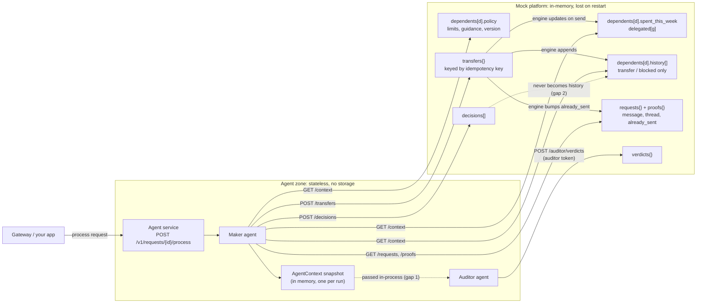
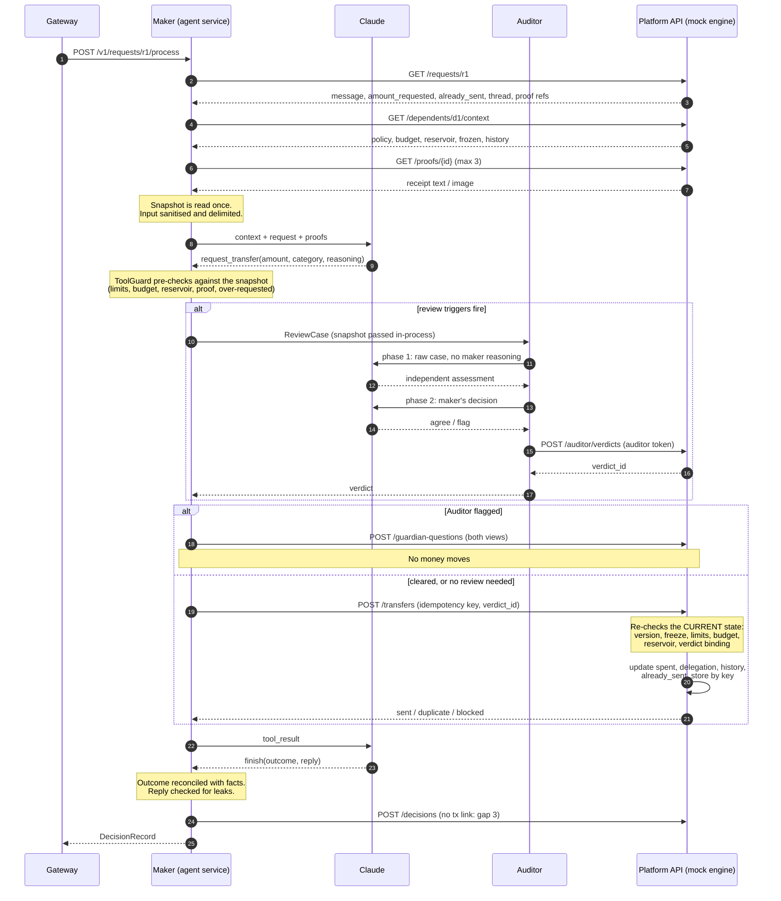

# Agent Layer

The agentic AI layer of the Sigil platform: the **maker agent** that runs a dependent's
allowance, the independent **Auditor agent** that checks larger or riskier transfers, and
the **scheduled triggers** that wake them. See
[the system architecture](<Delegated Financial Guardianship — System Architecture.md>).

## The agents: responsibilities, inputs, outputs

### Maker ([`maker/agent.py`](src/agent_layer/maker/agent.py))

Decides what happens to each request and runs the allowance. It never holds keys,
chooses a recipient, changes policy or writes to a database.

| Responsibility | Entry point | Uses the model? |
|---|---|---|
| Judge a dependent's request: send full or partial, counter-offer, ask for proof, ask the guardian, or decline | `MakerAgent.handle_request` | Yes |
| Send the weekly allowance, adjusted within the guidance | `MakerAgent.run_allowance` | Yes |
| Draft a policy from the guardian's chat, with test scenarios and open questions | `flows/policy.py: draft_policy` | Yes |
| Write the weekly summary | `flows/scheduled.py: weekly_summary` | Wording only; pattern flags are code |
| Warn the dependent when spending runs fast | `flows/scheduled.py: pace_check` | No |
| Ask the guardian for a top-up before the reservoir runs dry | `flows/scheduled.py: reservoir_check` | No |
| Propose "stop asking" policy updates from the guardian's answers | `flows/scheduled.py: learning_proposals` | No |

**Inputs**, all read through `MakerAPI`:

| Input | Platform call |
|---|---|
| The request: the dependent's words, amount asked, amount already sent, emergency flag, conversation so far, verified guardian answers | `GET /requests/{id}` |
| Proof: images go to the model through vision, text goes as delimited data | `GET /proofs/{id}` |
| Signed policy view (outer limits and private guidance), week's budget, reservoir, freeze flag, recent history | `GET /dependents/{id}/context` |
| Guardian's past answers (for learning) and the week's activity (for the summary) | `GET /guardians/{id}/answers`, `GET /dependents/{id}/weekly-activity` |
| The guardian's chat (for policy drafting) | Inbound `POST /v1/policy-drafts` |
| Wake-ups | Scheduler, or inbound `POST /v1/jobs/{name}` |

**Outputs.** The model can call only these tools; code validates each call, then turns it into a platform call:

| Tool | Becomes | Notes |
|---|---|---|
| `request_transfer(amount, purpose, category, category_confidence, reasoning)` | `POST /transfers` | No recipient field; code adds the idempotency key and, when review is required, the Auditor's verdict id |
| `ask_for_proof(kind, reason)` | `POST /proof-requests` | Request mode only |
| `ask_guardian(question, recommendation, recommended_amount, urgency)` | `POST /guardian-questions` | At most one per run |
| `propose_policy_update(change, evidence)` | `POST /policy-proposals` | Takes effect only if the guardian signs it |
| `notify_guardian(message)` | `POST /notifications` | Informational note |
| `finish(outcome, reply_to_dependent, summary_for_guardian)` | `POST /decisions` | Ends every run. Code corrects the outcome if it doesn't match what happened, and checks the reply before recording it |

Code-only outputs: pace warnings and the weekly summary (`POST /notifications`),
top-up questions (`POST /guardian-questions`), and guardrail events (`POST /events`).

### Auditor ([`auditor/auditor.py`](src/agent_layer/auditor/auditor.py))

The guardian's advocate. It reviews a transfer the maker wants to make when a trigger in
[`auditor/triggers.py`](src/agent_layer/auditor/triggers.py) fires, before the engine
sees it. It can only make an outcome stricter: it never approves, raises an amount,
talks to the dependent or calls the engine.

| | |
|---|---|
| **Triggers** | Engine-verifiable: amount ≥ review threshold, emergency claimed, amount over 2× the usual, new category, allowance above usual. Agent-side (can only add reviews): category confidence < 0.7, manipulation signals in the input |
| **Inputs, phase 1** | The dependent's words, proof (text and images), guidance, budget, recent history, and why it is reviewing. Not the maker's reasoning |
| **Inputs, phase 2** | The maker's amount, category, confidence, purpose and reasoning |
| **Output** | `agree`, or `flag` with a reason and concerns, posted with the Auditor's own token to `POST /auditor/verdicts` and bound to the transfer's idempotency key, amount and category |
| **On a flag** | No money moves; the maker's code asks the guardian with both views (`POST /guardian-questions`) |
| **On failure** | Any error, refusal, exhausted budget or unrecordable verdict counts as a flag |

### Where the data lives

The agent layer stores nothing. Each run reads a snapshot from the platform API; in this
repo the platform is the in-memory mock, so all state is lost on restart.



### One request, from start to finish

The snapshot is read once at the start. The engine re-checks every transfer against its
*current* state, which is what catches a freeze or policy change mid-run.



### Known gaps

1. **The Auditor doesn't fetch its own context.** It receives the maker's snapshot
   in-process, so a compromised maker could feed it a doctored history or guidance. The
   engine's limits still hold, but the intent check could be fooled. Fix: the Auditor
   reads context with its own token.
2. **History only records money events.** Declines and guardian questions are written
   to `POST /decisions` but never appear in `history`, so the next run can't see them.
   The real engine should build history from the decision log. (The mock does this for
   `out_of_scope` only, as a `kind: "out_of_scope"` item, so the weekly flag can be
   tested.)
3. **The decision record doesn't link to the transaction.** `DecisionRecord` lacks the
   engine's `decision_id` and the `tx_signature` that the audit trail needs.
4. **No guardian answers in threads.** `guardian_answer` messages exist in the contract,
   but neither the mock nor its admin routes can add one, so "the guardian answered, now
   continue" isn't testable end to end.
5. **No image dimension or content checks.** The agent checks a proof's type label,
   base64 and exact size, but cannot read dimensions or confirm the bytes match
   `media_type`, and nothing strips EXIF/GPS metadata. Proposal: the platform normalises
   images at upload. See [proof-images.md](proof-images.md).
6. **Proof images are re-sent and re-billed on every model turn.** Only the system
   prompt is cached. A cache breakpoint on the first user turn would make re-sends
   cache reads. See [proof-images.md](proof-images.md).
7. **No body size limit on the inbound API.** FastAPI/uvicorn read the whole request
   body before validating it. Set a limit in the gateway or a reverse proxy.
8. **Proof forgery is limited, not solved.** The agent and engine catch mis-paired,
   typed, tampered and reused proofs, but a convincing fake from a new shop still gets
   through, up to `max_per_request`. Near-duplicate detection (perceptual hashing) and
   metadata flags are the platform's job and aren't in the mock. See
   [proof-images.md](proof-images.md#proof-integrity).

### Differences from the architecture doc

- The model ends every run with `finish` (explicit outcome plus reply), so decisions are structured and loggable.
- `notify` is narrowed to `notify_guardian`; the dependent's reply goes through `finish`, and pace warnings are code.
- Pace, reservoir, pattern flags and learning proposals are deterministic code, not model calls.
- The Auditor also sees the proof, and manipulation signals in the input force a review.
- Two more outcomes: `asked_dependent` (a clarifying question) and `out_of_scope` (not
  about the allowance). A request with no stated amount can't move money.

## Isolation: everything goes through the platform API

The agent zone has no database, no file access and no keys. Every read (policy, budget,
history, requests, proofs) and every action (transfer, guardian question, notification,
decision log) is an HTTP call to the platform API in
[`platform_api.py`](src/agent_layer/platform_api.py). The engine decides; the agent asks.

| Layer | How it is enforced | Tested in |
|---|---|---|
| Static | No DB drivers, key libraries, subprocess, file or socket APIs in the package; only `platform_api.py` (and `llm.py` for Claude) do network I/O | `tests/test_isolation.py` |
| Runtime | [`sandbox.py`](src/agent_layer/sandbox.py) installs a CPython audit hook: no file writes, reads only under code roots, no subprocess/ctypes/SQLite, no DB-driver imports, DNS and connections only to allowlisted hosts | `tests/test_isolation.py` (full request run inside the sandbox) |
| Credentials | The maker and the Auditor use separate platform tokens; only the Auditor's token can post a verdict | `tests/test_auditor.py` |

Production should add container-level isolation too (read-only filesystem, egress
firewall, no DB credentials in the agent's environment).

## Guardrails

| Stage | Guardrail | Where |
|---|---|---|
| Input | Unicode normalisation, hidden/zero-width characters stripped, length caps, thread and proof caps | `guardrails/input.py`, `maker/context.py` |
| Input | Dependent text and proofs wrapped in `<untrusted_…>` tags that cannot be closed from inside (HTML-escaped) | `guardrails/input.py` |
| Input | Injection signals in English and Chinese (instruction override, claimed guardian approval, role play, authority claims, urgency, wallet addresses) are shown to the model and **force an Auditor review**; they never block on their own | `guardrails/input.py`, `auditor/triggers.py` |
| Platform | Responses over 8 MB, invalid JSON or outside the contract (hard length ceilings on every text field and list) raise `PlatformAPIError`: the run fails closed | `platform_api.py`, `contracts.py` |
| Platform | Zero trust: platform text in a prompt (guidance, names, history purposes, verified guardian answers, events, engine reasons, and the maker's reasoning shown to the Auditor) is capped, stripped and escaped like user input; inline fields are collapsed to one line | `guardrails/input.py` (`PlatformText`), `maker/context.py` |
| Platform | A trusted channel that needed fixing (hidden characters, oversized, markup), or a proof whose bytes don't match its declared size, adds `platform_text_anomaly` and **forces an Auditor review** | `guardrails/input.py`, `maker/context.py` |
| Tools | Allowlisted tools per mode; strict Pydantic arguments (`extra="forbid"`, so no recipient can be added); display amounts with max 2 decimals converted to integer base units | `guardrails/tools.py`, `contracts.py` |
| Tools | Pre-checks before any API call: frozen, blocked category, per-request max, weekly budget, reservoir, **an amount stated in `amount_requested`** (never guessed from the chat), not more than requested, proof threshold, allowance ceiling (1.5× usual) | `guardrails/tools.py` |
| Proofs | A proof counts toward the threshold only if it belongs to this request, its bytes match the platform's hash, it is an image or platform-extracted (`ocr`) text, and it isn't a duplicate or AI-generated (with `AGENT_CAMERA_ONLY_PROOFS`, it must also be a verified in-app capture). Above the threshold the model must report `proof_findings` (merchant, date, total, receipt number, matches claim); a mismatch or a total below the amount is refused. Platform flags (near-duplicate, screenshot, old, edited, AI-suspected, re-photographed screen) force an Auditor review | `maker/context.py`, `guardrails/tools.py` |
| Tools | Per-run limits: 1 transfer, 1 guardian question, 10 tool calls, 8 model turns | `config.py` |
| Tools | Idempotency key derived by code from request state (`req:{id}:{thread length}`, `allowance:{dep}:{iso week}`), never chosen by the model | `maker/agent.py` |
| Auditor | Required when trusted triggers fire (amount ≥ review threshold, emergency, off-pattern amount, new category, allowance above usual) or agent triggers fire (low category confidence, injection signals) | `auditor/triggers.py` |
| Auditor | Two phases: an independent view of the raw case **before** reading the maker's reasoning, then a verdict. A "concerned" view cannot flip to "agree". Fails closed: any error means a flag. A flag means no money moves, and the guardian is asked with both views | `auditor/auditor.py` |
| Output | Reply to the dependent is replaced, in the dependent's language, if it leaks the guardian's guidance (7 English words or 10 Chinese characters in a row), a wallet address or anything that looks like a secret; capped in length at a word or clause break | `guardrails/output.py` |
| Output | The model's claimed outcome is reconciled with what actually happened (e.g. "sent" with no transfer becomes "declined", "out_of_scope" after asking the guardian becomes "asked_guardian"), and the reply is replaced when corrected | `guardrails/output.py` |
| Scope | Off-topic messages ("what is 1+1?", homework, chat) end as `out_of_scope` with a short redirect; a reply over 200 (Han characters count 3) means the model answered the question, so it is replaced. Unclear requests end as `asked_dependent`. Three or more off-topic messages in a week are flagged in the guardian's summary | `maker/prompts.py`, `maker/agent.py`, `flows/scheduled.py` |
| Run | Model outage, refusal, `max_tokens`, missing `finish`, loop limit or exhausted family token budget all end in a **safe fallback**: no further money moves and the guardian is asked | `maker/agent.py`, `guardrails/budget.py` |

The engine, signer and chain remain the authoritative limits. These guardrails make the
agent fail early, safely and explainably.

## Languages

The agent supports English, Simplified Chinese and Traditional Chinese
([`i18n.py`](src/agent_layer/i18n.py)). Each run tells the model which language to
write in for each reader, and every fixed text code sends to a person exists in all
three.

| Reader | Language |
|---|---|
| Dependent | The language and script of their latest message; if too short to tell (`"10?"`), their profile locale; otherwise English |
| Guardian (summaries, questions, notes, Auditor reasons) | Their profile locale; otherwise the language their guidance is written in; otherwise English |

Profile locales come from the platform as optional BCP 47 tags on the context
(`dependent_locale`, `guardian_locale`: `en`, `zh-CN`, `zh-TW`, `zh-HK`, …).
Unsupported tags are ignored. Purposes, reasoning and guardrail events stay in whatever
language the model or code wrote them in; they are not shown to people as-is.

The Chinese fixed texts and injection patterns should be reviewed by a native speaker
of each script before launch. Adding a language means a column in `i18n.py`, patterns in
`guardrails/input.py`, and a script rule in `detect_locale`.

## Layout

```
src/agent_layer/
  contracts.py      platform API payloads, tool arguments, Auditor outputs
  platform_api.py   MakerAPI / AuditorAPI: the only way out of the agent zone
  llm.py            LLM port + AnthropicLLM (Claude Opus 5.5, adaptive thinking, refusal fallbacks)
  i18n.py           languages: who gets which, and every fixed text in en / zh-Hans / zh-Hant
  guardrails/       input, tools, output, budget
  maker/            system prompt, tool schemas, context builder, the agent loop
  auditor/          prompts, review triggers, the two-phase Auditor
  flows/            scheduled actions (pace, reservoir, summary, learning) and policy drafting
  scheduler.py      APScheduler jobs
  service.py        inbound HTTP API for the gateway
  sandbox.py        runtime isolation (audit hook)
mock_platform/      in-memory mock of the platform API (engine semantics), served over HTTP
tests/              unit, end-to-end, attack, isolation and adapter tests
```

## Platform API contract (consumed by the agent)

All under `/agent/v1`, bearer-authenticated. Money is integer base units (6 decimals).

| Method | Path | Token |
|---|---|---|
| GET | `/dependents`, `/dependents/{id}/context`, `/dependents/{id}/weekly-activity` | maker |
| GET | `/requests/{id}`, `/proofs/{id}`, `/guardians/{id}/answers`, `/usage/{family}` | maker |
| POST | `/transfers` (with `Idempotency-Key` header; no recipient field) | maker |
| POST | `/guardian-questions`, `/proof-requests`, `/policy-proposals`, `/notifications` (deduped by `dedupe_key`) | maker |
| POST | `/decisions`, `/events`, `/usage`, `/policy-drafts/validate` | maker |
| POST | `/auditor/verdicts` | **auditor only** |

The engine must refuse a transfer that needs review (`auditor.triggers.trusted_triggers`)
unless it carries an unused `agree` verdict bound to the same idempotency key, amount and
category. `mock_platform/app.py` implements this as a reference.

Responses must stay within the contract, or the agent fails closed (`PlatformAPIError`,
so `502` to the gateway, and no model call):

- A response body of at most ~8 MB (one proof at the 5 MB limit, base64-encoded).
- Valid JSON that matches `contracts.py`, including its hard length ceilings
  (`MAX_TEXT`, `MAX_SHORT_TEXT`, `MAX_GUIDANCE`, `MAX_ITEMS`, `MAX_PROOF_B64`).
- For an image proof, `size_bytes` equal to the decoded length of `data_b64`. A mismatch
  skips the proof and forces an Auditor review.

Proofs carry integrity fields (`request_id`, `dependent_id`, `uploaded_at`, `sha256`,
`source`, `flags`), and transfers carry `proof_ids` and `proof_findings`. Above the
proof threshold, the engine must require an unused proof for that request and mark it
used in the same transaction as the transfer, so one receipt backs one transfer.
`mock_platform/app.py` implements this as a reference. Requirements, upload rules and
open questions: [proof-images.md](proof-images.md).

## Inbound API (called by the gateway)

| Method | Path | |
|---|---|---|
| POST | `/v1/requests/{request_id}/process` | Run the maker on a dependent's request; returns the decision |
| POST | `/v1/policy-drafts` | Draft a policy from the guardian's chat (the guardian signs; the agent never activates) |
| POST | `/v1/jobs/{allowance\|pace\|reservoir\|weekly_summary\|learning}` | Run a scheduled job now |

All require `Authorization: Bearer $AGENT_INBOUND_TOKEN`; with no token configured, every
call is refused.

## Running

```bash
pip install -e ".[dev]"
pytest                      # full suite, no network or API key needed
pytest -m live              # also hit the real Claude API (needs ANTHROPIC_API_KEY; costs money)

python -m mock_platform.server          # mock platform with a demo family on :8200
PLATFORM_API_URL=http://127.0.0.1:8200 \
PLATFORM_MAKER_TOKEN=maker-test-token PLATFORM_AUDITOR_TOKEN=auditor-test-token \
AGENT_INBOUND_TOKEN=change-me python -m agent_layer   # agent service on :8100
```

Or both in containers (mock platform on :8200, agent service on :8100):

```bash
ANTHROPIC_API_KEY=sk-... docker compose up --build
```

[walkthrough.md](walkthrough.md) drives both services step by step with HTTPie. Every
command in it is also a test (`pytest tests/test_walkthrough.py`).

Optional settings: `AGENT_MAKER_MODEL`, `AGENT_AUDITOR_MODEL` (both default to
`claude-opus-5-5`), `AGENT_MAKER_EFFORT`, `AGENT_AUDITOR_EFFORT`, `AGENT_SCHEDULER=0`,
`AGENT_CAMERA_ONLY_PROOFS=1` (only verified in-app captures count as proof; turn on with
the engine's matching rule once the app's camera flow ships).
