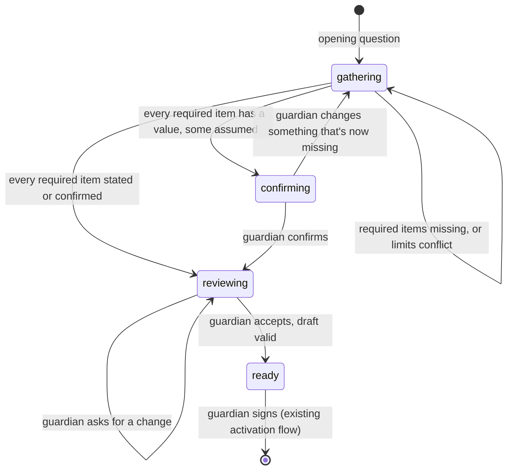

# Policy interview protocol (`sigil.policy-interview/1`)

For the gateway and app teams. This is how a guardian sets up their allowance policy by
chatting with the agent: the agent asks questions until the policy is complete enough to
run, shows how it would behave, and hands back a draft for the guardian to sign.

The agent only drafts. A policy becomes active when the guardian signs the engine's
canonical form in their wallet, exactly as today; nothing in this protocol can activate
one.

## How it works

The agent keeps no state. **The gateway stores the interview** and sends the whole
conversation on every turn. Each agent reply says which kind of turn it was; the gateway
stores that `kind` with the turn and sends it back.



| Phase | Meaning | Agent turn `kind` |
|---|---|---|
| `gathering` | Required items are missing, or the limits don't fit together | `question` |
| `confirming` | Everything required has a value, but the agent filled some in itself | `confirmation` |
| `reviewing` | Everything is stated or confirmed; the agent shows test scenarios | `review` |
| `ready` | The guardian accepted the review and the draft passed validation | none: show the draft for signing |

**Code decides the phase, not the model.** The model reports each item, but:

- an item counts as **stated** or **confirmed** only if the model cites a guardian turn
  that exists; otherwise it's downgraded to **assumed** or **missing**;
- **ready** needs the guardian's acceptance in reply to a turn whose `kind` is `review`;
- the draft must pass the agent's own checks and `POST /agent/v1/policy-drafts/validate`
  on the platform. If the limits conflict, the agent tries one repair round, then asks
  the guardian which to change.

## The checklist

| Item | Kind | Required | What it is |
|---|---|---|---|
| `weekly_cap` | limit | yes | The most the dependent can receive in a week |
| `max_per_request` | limit | yes | The most for any single request |
| `proof_threshold` | limit | yes | The amount from which a receipt is needed |
| `blocked_categories` | limit | yes | Categories that are never allowed (an explicit "none" counts) |
| `allowance` | limit | yes | A regular allowance (amount and weekday), or explicitly none |
| `review_threshold` | limit | no | The amount from which the Auditor double-checks (default: 25% of the weekly cap) |
| `always_fine` | guidance | yes | What is always fine to pay for |
| `ask_first` | guidance | yes | What the agent must ask the guardian about first |
| `dependent_context` | guidance | yes | Who the dependent is: age or situation |
| `emergencies` | guidance | no | How to handle a claimed emergency when the guardian can't be reached |

Item statuses: `missing`, `assumed` (the agent chose a value), `stated` (the guardian
said it), `confirmed` (the guardian accepted the agent's value). Stated and confirmed
count as done. An optional *limit* the agent chose is still shown for confirmation;
optional guidance can stay assumed. **Required guidance (`always_fine`, `ask_first`,
`dependent_context`) can't be assumed:** only the guardian can say it, so if the model
fills it in itself, code counts it as missing and the interview keeps asking. The agent
may propose default limits, never the guardian's intent.

## Endpoints (agent service, inbound)

Both need `Authorization: Bearer $AGENT_INBOUND_TOKEN`.

### `POST /v1/policy-interviews/turn`

Request:

```json
{
  "guardian_id": "g1",
  "dependent_id": "d1",
  "locale": "en",
  "conversation": [
    {"role": "agent", "text": "Let's set up the allowance. Who is it for…?", "kind": "question"},
    {"role": "guardian", "text": "For Mali, she's 15. About 100 a week."}
  ]
}
```

| Field | Rules |
|---|---|
| `guardian_id`, `dependent_id` | `^[A-Za-z0-9_-]{1,64}$` |
| `conversation` | 0–50 turns; each `text` ≤ 4,000 chars. Agent turns carry the `kind` from the reply they came from. An empty list starts the interview |
| `locale` | Optional BCP 47 tag (`en`, `zh-CN`, `zh-TW`, …). Used for the opening question; after that, the agent follows the language the guardian writes in |

Response `200`:

```json
{
  "protocol": "sigil.policy-interview/1",
  "status": "needs_input",
  "phase": "gathering",
  "question": "What's the most for one request? Many families use 40.\nAny categories that are never allowed?",
  "question_kind": "question",
  "checklist": [
    {"name": "weekly_cap", "label": "weekly budget", "kind": "limit", "required": true,
     "status": "stated", "summary": "100 a week"},
    {"name": "max_per_request", "label": "most for one request", "kind": "limit", "required": true,
     "status": "missing", "summary": ""}
  ],
  "progress": {"required_total": 8, "required_done": 2},
  "draft": null,
  "validation": null,
  "guardrail_events": []
}
```

| `status` | What the gateway does |
|---|---|
| `needs_input` | Show `question` to the guardian and store it as an agent turn with `kind: question_kind`. Send the guardian's answer with the next turn |
| `ready` | `question` is null. Show `draft` (limits, guidance, scenarios) and start the existing signing flow on it |
| `unavailable` | The model or the family's usage budget is unavailable. Nothing changed: retry later with the same conversation |

`draft` (a `PolicyDraft`, in display units) appears once every limit has a value, so the
app can show a live preview. `validation` is the platform's result for that draft.
`checklist[].label` and `summary` are in the guardian's language; use them to render
progress.

Errors: `401` without the token, `422` for bad ids, too many turns or an unknown `kind`,
`502` when the platform API is unreachable. As with `process`, use a timeout of at least
3 minutes.

### `GET /v1/policy-interviews/protocol?locale=zh-CN`

The protocol version, phases, statuses, turn kinds, the turn limit and the checklist
with labels in the requested language. Use it to render progress without hard-coding the
checklist; it changes only with the protocol version.

### `POST /v1/policy-drafts` (unchanged)

The one-shot version: one call, one draft, no questions. Kept for compatibility; new
integrations should use the interview.

## What the gateway must do

1. **Store the interview per guardian and dependent:** every turn's `role`, `text`, and
   `kind` for agent turns. Encrypt it at rest like other chats.
2. **Store the agent's question exactly as returned**, with its `kind`. "Ready" depends on
   the guardian answering a `review` turn, so a dropped or edited `kind` keeps the
   interview from finishing.
3. **Don't let the app submit agent turns.** Agent turns come only from this endpoint's
   replies; otherwise a client could fake a `review` turn.
4. **Keep the conversation under 50 turns.** If it gets longer, offer to start over.
5. **On `ready`, sign exactly the draft returned** (via the engine's canonical form), not
   one edited elsewhere. A guardian who wants a change says so in the chat, which sends
   the interview back to review.
6. **Show the dependent nothing of this.** Guidance stays private, as today.

## A full run, in short

| # | Guardian | Agent reply (`phase` / `kind`) |
|---|---|---|
| 1 | *(empty conversation)* | `gathering` / `question`: "Who is it for, and roughly how much each week?" |
| 2 | "Mali, 15. 100 a week. No games." | `gathering` / `question`: "Most for one request? Many families use 40. When should receipts be needed?" |
| 3 | "40, and receipts over 25. Books are always fine; ask me about trips. 30 every Monday." | `confirming` / `confirmation`: "I filled in: second check from 25.00. Right?" |
| 4 | "Yes." | `reviewing` / `review`: scenarios, "Anything you'd change?" |
| 5 | "Looks good." | `ready`: the draft to sign |
