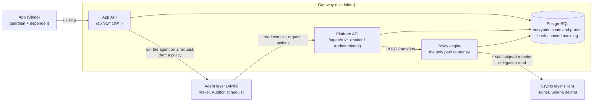
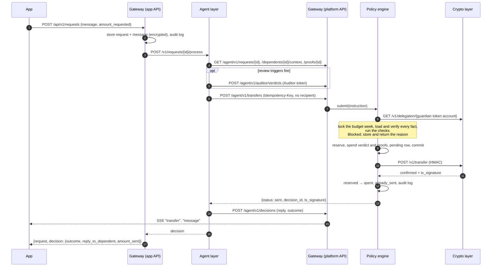

# Gateway Layer

The gateway layer of the Sigil platform: the **app API** that the guardian and dependent apps
call, the **platform API** that the agent layer calls, the deterministic **policy engine**
that is the only code allowed to move money, the **database** with its hash-chained audit
log, and the signed client for the **crypto layer**.

This repo's docs are the single source of truth for the whole project: [SPEC.md](SPEC.md)
for requirements and decisions (its §0 says where each fact lives),
[docs/architecture.md](docs/architecture.md) for the design rationale, this README for the
gateway's interfaces, and one guide per layer in [docs/](docs/).

Sigil is four services that talk over HTTP:

| Layer | Owner | What it does |
|---|---|---|
| App | Shine | Native iOS app for guardians and dependents, Phantom wallet, signing UX |
| Agent | Alwin | Maker agent, Auditor agent, scheduler ([`agent/`](../agent)) |
| **Gateway (this folder)** | Julian | Everything between the other three, and the only place money decisions are made |
| Crypto | Han | Signer holding the delegate key; signs `transfer_checked` on Solana devnet |

## Responsibilities

| Responsibility | Where | Interface |
|---|---|---|
| Sign-In With Solana, sessions, roles | `app_api/auth.py`, `app_api/sessions.py` | App API |
| Families: register the dependent's wallet and token account, wallet-signed | `app_api/families.py` | App API |
| Policy setup: run the guardian's policy interview with the agent (storing the conversation), turn the agreed draft into a numbered draft, activate it only with the guardian's signature | `app_api/interview.py`, `app_api/policy.py` | App API, agent inbound API |
| Requests, conversation and proofs; run the agent on each new message or proof | `app_api/requests.py` | App API, agent inbound API |
| Verified in-app capture: attest the dependent's iPhone (App Attest), issue capture tickets, verify signed receipts | `capture/`, `app_api/capture.py` | App API |
| Guardian decisions: signed answers to the agent's questions, the freeze switch | `app_api/guardian.py` | App API |
| Budget, history, notifications, audit trail, live events | `app_api/reads.py`, `events.py` | App API |
| Everything the agent reads and every action it requests | `agent_api/` | Platform API (`/agent/v1/*`) |
| **Decide every transfer** against the guardian's signed policy | `engine/` | — |
| Ask the crypto layer to sign and send cleared transfers; read delegations | `crypto_client.py` | Crypto API |
| Persist everything; encrypt chats and proofs; hash-chain the audit log | `db/` | — |
| Request size limits and rate limits | `protection.py` | — |

**It never** holds a key that can move money, lets the agent choose a recipient, lets a
chat message stand in for the guardian, or trusts the agent's account of what it did. The
agent asks; the engine decides; the crypto layer signs only what the engine cleared.



## One transfer, from start to finish



## The policy engine

`engine/checks.py` is one pure function: facts in, "cleared" or a blocked reason out. No
database, network, clock or randomness, so every rule is unit-tested. `engine/transfers.py`
loads and verifies the facts and runs the money transaction around it.

### Checks, in order (the first failure blocks)

| # | Check | Blocked reason |
|---|---|---|
| 1 | The dependent and family exist | `unknown dependent` |
| 2 | The family is not frozen | `frozen by guardian` |
| 2a | Request: fewer than 3 receipts are owed for money already sent (pending transfers that will owe one included) | `proof outstanding` |
| 3 | An active policy exists, its stored hash matches its body, and the guardian's signature covers that hash and version (re-verified every time) | `no active policy` / `policy signature invalid` |
| 4 | The instruction names the active version | `stale policy version` |
| 5 | The destination was registered with a valid guardian signature | `recipient not registered` |
| 6 | The category is not blocked | `blocked category` |
| 7 | Request: amount ≤ `max_per_request`. Allowance: amount ≤ the signed allowance, `request_id` empty, key = `allowance:{dependent}:{ISO week}` | `over max per request` / `over allowance` / `invalid allowance` / `no allowance in policy` |
| 8 | spent + reserved + amount ≤ `weekly_cap` | `over weekly cap` |
| 9 | amount ≤ on-chain delegation − money pending from the same reservoir (all of the guardian's dependents); the delegate is the agent wallet **and the token account is owned by the guardian** | `insufficient delegation` |
| 10 | Request: exists, belongs to the dependent, has an amount, and amount ≤ `amount_requested − already_sent − pending` (money cleared but not yet confirmed may still go out) | `unknown request` / `no amount requested` / `over requested amount` |
| 11 | If the review rule fires: an unused `agree` verdict bound to this idempotency key, amount, category and dependent | `auditor verdict required` / `auditor verdict invalid` |
| 12 | Proofs belong to this request, and any proof the agent attaches counts, is unused and covers the amount. Proof is **not** required up front (see "Proof after payment") | `unknown proof` / `proof not for this request` / `proof already used` / `proof does not cover the transfer` |

**Proof after payment.** A dependent cannot buy anything before being paid, so a request
at or above `proof_threshold` with no counting proof is **sent first**, after an Auditor
review (review trigger `pay_first`), and leaves a receipt owed (`transfers.proof_owed`, then
a row in `proof_obligations` once the money lands; the transfer result carries it as
`proof_owed`). A dependent may owe up to **3** receipts (`MAX_OPEN_OBLIGATIONS` in
`engine/checks.py`), counting transfers that will owe one but are still pending. At 3 the
dependent gets no more money: `POST /requests` returns `409 PROOF_OUTSTANDING` and the
engine blocks a request transfer with `proof outstanding` (check 2a). A guardian override
does not lift it. The
scheduled allowance still runs, since it is the guardian's own standing instruction. Only
attached proofs that count as evidence back a transfer and have their keys spent, so a
receipt shown as a non-counting file can still settle what is owed. Once a receipt is
owed, the agent sees only the proofs sent since. The agent sees the open receipts in its context (`proofs_owed`, `max_proofs_owed`)
and on the request that owes one (`proof_owed`). The obligation is settled through
`POST /agent/v1/proof-obligations/{id}/settle`,
where the agent names the proof it read and what it found: under the reservoir lock, the
gateway applies the engine's rules (the proof belongs to the request, counts as proof with
camera-only mode applied, has not backed a transfer for any of the guardian's dependents,
matches no receipt used in any family, covers the amount) and spends its keys against the
transfer it settles, so a model cannot clear a debt by asserting it is paid and one receipt
still backs one payment.

**Review rule.** `engine/triggers.py` is a copy of the agent layer's `trusted_triggers`
(amount ≥ review threshold or 25% of the cap, emergency, off-pattern amount, new category,
allowance above usual, and paying first: amount ≥ proof threshold with no counting proof). The engine and the agent must agree; a parity test runs both on
1,296 cases.

**Guardian override.** When the guardian has signed "approve N" for a request, the engine
finds that answer itself and re-verifies its signature. Exactly that amount may then pass
checks 7, 8 and 11. It never skips freeze, an outstanding receipt, the signed
policy, the destination, delegation or the requested amount. The agent has no way to claim an approval.

**Allowance.** Capped by the guardian's signed allowance amount, not by `max_per_request`
(which is for one-off requests). One allowance per ISO week, enforced by the key. Raising
it needs the guardian.

### The transaction

1. A known idempotency key returns its stored result: `duplicate` if sent, the same reason
   if blocked, and a pending transfer is retried (the crypto layer is idempotent on the key).
2. The delegation is read from the crypto layer. Then the reservoir is locked (an advisory
   lock on the guardian's token account, shared by all of their dependents), then the
   family's budget row for the week (`SELECT … FOR UPDATE`), and every fact is loaded and
   verified.
3. Blocked: the decision is stored and logged. Cleared: the amount is reserved, the verdict
   and proof keys are spent, a pending transfer is stored, all in one commit.
4. The crypto layer is called outside any lock. **Confirmed:** reserved → spent,
   `already_sent` raised, signature stored. **Refused (4xx):** reservation released,
   `signer failed: <code>`. **Unknown (network, 5xx):** returns `status: "pending"`, never
   `blocked`, and keeps the reservation. A background job retries every pending transfer by
   its own key at startup and every `PENDING_RETRY_SECONDS`; the crypto layer never signs a
   key twice.

## Security controls

| SPEC | Control | Where | Proven by |
|---|---|---|---|
| SEC-01 | No recipient in anything the agent sends (`extra="forbid"`); the engine resolves the registered destination | `contracts/agent.py`, `engine/transfers.py` | `test_contracts.py`, `test_agent_api.py` |
| SEC-02 | Only the engine builds crypto transfers | `engine/transfers.py` | `test_isolation.py` |
| SEC-04 | Policy enforced only with the guardian's signature over its hash and version, re-verified on every transfer | `engine/transfers.py`, `app_api/policy.py` | tampered policy, forged activation |
| SEC-05 | Guardian approvals count only as wallet signatures over decision, amount and nonce | `app_api/guardian.py`, `engine/transfers.py` | forged and wrong-amount approvals |
| SEC-06 | A transfer that needs review cannot clear without a matching, unused Auditor verdict; only the Auditor token can post one | `engine/checks.py`, `agent_api/auth.py` | skip-audit, verdict reuse, maker posting a verdict |
| SEC-07 | One idempotency key, at most one transfer, including retries and crashes | `engine/transfers.py`, unique key | replay test, pending retry |
| SEC-08 | Budget updates under a row lock in one transaction; a reservoir lock across a guardian's dependents | `engine/transfers.py` | two parallel transfers over the cap; two dependents racing for one delegation |
| SEC-09 | SIWS: single-use 5-minute nonces bound to wallet, purpose and domain; JWT ≤ 12 h | `app_api/auth.py`, `app_api/nonces.py` | replay, other domain, wrong key, expiry, wrong purpose |
| SEC-10 | Role and family checked on every route; dependents never see guidance; other families get 404 | `app_api/sessions.py` | role and cross-family tests |
| SEC-11 | Rate limits, body size limits, per-guardian LLM token budget | `protection.py`, `agent_api/` | 413, streamed 413, 429, usage |
| SEC-15 | Request messages, thread, proofs, notifications and agent replies encrypted at rest (Fernet) | `db/models.py` | raw-bytes tests |
| SEC-16 | Append-only, hash-chained audit log; a trigger blocks edits even by the owner | `db/audit_log.py`, migration | tamper detection, permissions |
| SEC-17 | Signed freeze blocks every transfer immediately | `app_api/guardian.py`, engine check 2 | freeze and unfreeze |
| SEC-19 | Errors use one envelope, never stack traces or upstream details | `core/errors.py`, `agent_client.py` | error tests |
| SEC-20 | Missing or unverifiable data blocks (default deny) | `engine/checks.py` | per-check tests |
| — | Reservoir ownership: only spend from a token account owned by the guardian | `engine/transfers.py` | another family's reservoir |
| — | One receipt backs one transfer (id, hash and receipt fingerprint), across requests and across a guardian's dependents, and across all families (keyed fingerprint) | `engine/proofs.py`, `used_proof_keys`, `receipt_fingerprints` | proof reuse tests |
| — | A transfer whose outcome is unknown counts against the request, so a new agent run cannot pay it twice | `engine/checks.py`, `engine/transfers.py` | `test_pending_transfer_cannot_be_paid_twice` |
| — | Proof images are re-encoded before storage: no EXIF, GPS or other metadata reaches the agent | `proof_images.py` | `test_proof_images.py`, `TestNormalisation` |
| — | A receipt is `photo` only if taken in our genuine iOS app on an App Attest-verified iPhone, unedited, for this request, within its ticket | `capture/` | `test_app_capture.py`, `test_capture_apple.py` |

Attack demos covered as tests: talking the agent into a large transfer (caps and override
rules), replayed request, revoked delegation, skipped audit, forged guardian approval,
tampered policy, re-used receipt.

## App API (for the app layer)

Base path `/api/v1`. JSON unless noted. Money is **integer base units** (aUSD has 6
decimals: `12500000` = 12.50). Every route except `/auth/*` needs `Authorization: Bearer
<token>`.

**Several dependents.** A guardian may support several dependents; each has their own
family (policy, budget, freeze, questions, interview, history, audit trail). A dependent has
exactly one guardian. Family-scoped routes act on the family named in the `X-Family-Id`
header; a guardian with one family may leave it out, and a guardian with several gets
`400 FAMILY_REQUIRED` without it. A family the caller doesn't belong to is `404`. All of a
guardian's dependents draw on one reservoir (one token account, one delegation), so a
second dependent must be registered with the same `guardian_token_account` (else `409`).
App guide: [docs/app-handoff.md](docs/app-handoff.md).

| Method | Path | Who | Body → response |
|---|---|---|---|
| POST | `/auth/nonce` | anyone | `{wallet, purpose}` → `{nonce, message, expires_at}`; `message` is the exact sign-in text for `purpose: "login"` |
| POST | `/auth/verify` | anyone | `{wallet, message, signature_b58}` → `{token, role, family_id, family_ids}` (`family_id` only when there is exactly one) |
| GET | `/me` | any session | `{user_id, wallet, role, family_id, family_ids, display_name, locale}` |
| POST | `/families` | guardian (add a dependent) | `{dependent_wallet, dependent_token_account, guardian_token_account, timezone?, dependent_name?, guardian_locale?, dependent_locale?, nonce, registration_signature_b58}` → `{family, token}` (use the new token) |
| GET | `/families` | any session | a guardian's families, oldest first (a dependent: their own) |
| GET | `/family` | member | the selected family |
| POST | `/policy/interview` | guardian | `{message?}` → `{status, phase, question, question_kind, checklist, progress, agent_draft, validation, draft, turns_used, max_turns}`; no message starts the interview |
| GET | `/policy/interview` | guardian | the open (or latest) interview: `{interview_id, status, turns, draft_policy_id}` |
| DELETE | `/policy/interview` | guardian | start over (the open interview is abandoned) |
| GET | `/policy/interview/protocol?locale=` | guardian | the checklist and phases, with labels in the guardian's language |
| GET | `/policy/drafts/{id}` | guardian | `{id, version, body, body_hash, test_scenarios, open_questions}` |
| POST | `/policy/drafts/{id}/activate` | guardian | `{nonce, signature_b58}` → active policy |
| GET | `/policy/active` | member | guardian: full body and hash; dependent: limits only, no guidance |
| GET | `/policy/proposals` | guardian | the agent's "stop asking" suggestions |
| POST | `/requests` | dependent | `{message, amount_requested?, emergency_claimed?}` → `{request, decision}` |
| POST | `/requests/{id}/messages` | dependent | `{message, amount_requested?}` → `{request, decision}` |
| POST | `/requests/{id}/proofs` | dependent | multipart `file`, `kind` (`receipt\|quote\|photo`), and for an in-app capture `capture_claim` + `capture_signature` → `{proof, decision}` |
| GET | `/proof-obligations` | member | receipts owed for money already sent: `{id, request_id, transfer_id, amount, created_at}`; while any is open the dependent cannot ask for more |
| POST | `/capture/challenge` | dependent | → `{challenge, expires_at}` for enrolling a phone |
| POST | `/capture/devices` | dependent | `{challenge, key_id, attestation_object}` (App Attest, base64) → device |
| GET | `/capture/devices`; DELETE `/capture/devices/{id}` | member | list; revoke (dependents their own iPhone, guardians any family device) |
| POST | `/requests/{id}/capture-tickets` | dependent | `{device_id}` → `{ticket, request_id, device_id, expires_at}` |
| POST | `/requests/{id}/process` | member | → `{request, decision}`; retry after `AGENT_UNAVAILABLE` |
| GET | `/requests`, `/requests/{id}` | member | list; detail with thread, proofs and decisions (each with the `transfer_id` it produced; guardian summaries for guardians only) |
| GET | `/questions?status=open\|answered` | guardian | the agent's questions |
| POST | `/questions/{id}/answer` | guardian | `{decision: approve\|deny, amount_units?, note?, nonce, signature_b58}` → `{question, decision}` |
| POST | `/freeze` | guardian | `{frozen, nonce, signature_b58}` → `{frozen}` |
| GET | `/budget` | member | `{week_start, spent, reserved, weekly_cap, remaining, delegated_remaining}` (`null` if the chain cannot be read) |
| GET | `/history` | member | `{items, transfers}` with transaction signatures |
| GET | `/notifications`; POST `/notifications/{id}/read` | recipient | the caller's notifications across all families, each with `family_id` (`null`: about all of a guardian's dependents); no `X-Family-Id` needed |
| GET | `/audit` | guardian | `{entries, chain_valid}`, verified on every read |
| GET | `/events` | member | Server-Sent Events: `message`, `question`, `transfer`, `notification` |

**`decision`** is the agent's move: `{outcome, reply_to_dependent, amount_sent}`. Show
`reply_to_dependent` to the dependent. `amount_sent` is the source of truth for money;
outcomes are the agent layer's (`sent_full`, `sent_partial`, `counter_offer`,
`asked_proof`, `asked_guardian`, `asked_dependent`, `declined`, `out_of_scope`,
`auditor_flagged`, `blocked`, `safe_fallback`, `transfer_pending`), and new ones may appear.
`transfer_pending` means the money is on its way (the crypto layer had not confirmed it yet):
show it as "on its way", with no retry button.

**Sign-in.** Get a nonce with `purpose: "login"`, have Phantom `signMessage` the returned
`message` exactly, send it to `/auth/verify`. A nonce works once, for 5 minutes, for that
wallet and purpose; a failed attempt burns it. Step-by-step guide with Phantom deeplinks:
[docs/auth-guide.md](docs/auth-guide.md).

**Policy interview.** The guardian sets up the policy by chatting with the agent (the agent
layer's `policy-protocol.md`, `sigil.policy-interview/1`). Call `POST /policy/interview`
with no message to get the opening question, then send each answer as `{message}`:

| `status` | Show |
|---|---|
| `needs_input` | `question` (its `question_kind` is `question`, `confirmation` or `review`), and progress from `checklist` and `progress`; `agent_draft` is a live preview once every limit has a value |
| `ready` | `draft`: the exact body (base units) and hash to sign with the `activate-policy` message below; the agent's scenarios are in `draft.test_scenarios` |
| `unavailable` | "Try again": nothing was stored, so send the same message again later |

The gateway stores the conversation, sends all of it to the agent every turn, and stores each
agent turn exactly as returned, with its kind. The app only ever sends the guardian's own
message; there is no way to submit an agent turn, so the `review` turn that "ready" depends
on can't be faked. To change something, the guardian says so in the chat. An interview holds
at most 50 turns (`409 INTERVIEW_TOO_LONG`: offer to start over); dependents see nothing of
it.

**Guardian signatures.** Get a nonce with the matching `purpose`, build the text below
exactly (UTF-8, `\n` line breaks, no trailing newline), sign it with Phantom
`signMessage`, send the base58 signature and the nonce. The server rebuilds the text from
its own data and never accepts a client-built message.

```
FinGuard:register-dependent      purpose: register-dependent
family:new
dependent_wallet:{pubkey}
dependent_token_account:{pubkey}
nonce:{nonce}

FinGuard:activate-policy         purpose: activate-policy   (version, body_hash from the draft)
family:{family_id}
version:{version}
hash:{body_hash}
nonce:{nonce}

FinGuard:answer-question         purpose: answer-question
family:{family_id}
question:{question_id}
decision:{approve|deny}
amount_units:{amount_units|none}
nonce:{nonce}

FinGuard:freeze                  purpose: freeze
family:{family_id}
frozen:{true|false}
nonce:{nonce}
```

**Proofs.** A JPEG, PNG or WebP image (typed from its bytes, not the `Content-Type`; send
iPhone photos as JPEG, not HEIC; at least 200 px), a **PDF** (an online order's receipt,
which cannot be photographed — see "Signed PDF receipts"), or plain text (stored as the
dependent's claim, never as evidence). Up to 15 MB as uploaded (a PDF up to 5 MB, since it is
sent to the agent as uploaded and the agent reads at most 5 MB), any number per request (each
counts towards the daily message quota; the agent reads the newest 3). The gateway applies
the EXIF rotation, strips all metadata (GPS included) by re-encoding, limits the long edge to
2,576 px and keeps the stored copy under 3.75 MB; the agent only sees that copy, and the
original is kept encrypted. Flags set at upload: `duplicate` (same bytes as an earlier proof from
any of the guardian's dependents), `near_duplicate` (perceptually the same picture), `no_camera_metadata`, `screenshot`,
`old_capture` (taken over 30 days ago), `edited` (editing software in the metadata) and
`camera_signed` (verified capture). Flags only make the agent more careful. A plain upload is
`source: "file"`; only a verified in-app capture (below) is `"photo"`.

**Signed PDF receipts.** A photo is tied to reality by App Attest; a PDF only by the
shop's own signature over it. At upload the gateway verifies any embedded signature
(`proof_pdf.py`): the `/ByteRange` must cover the whole file but the signature's own hole,
the signed digest must match the bytes, the signing certificate must chain to one of
`PDF_TRUSTED_ROOTS_PATH`, be in date now, and be meant for signing (its key usage and
extended key usage, when present, must allow document signatures), and its organisation
(or common name) must **exactly** match a name on `PDF_ALLOWED_SIGNERS` (Lazada today), so
"Not Lazada Ltd" is refused. Checked against a real Lazada Thailand receipt: the signer is
`LAZADA EXPRESS COMPANY LIMITED` (the default), issued by **Thai Digital ID CA G3**, under
Thailand's ETDA root. Since the chain check is one level, `PDF_TRUSTED_ROOTS_PATH` must hold
the Thai Digital ID CA G3 certificate, downloaded from Thai Digital ID or ETDA and checked by
fingerprint (never taken from a PDF, which can carry any certificate). Lazada's signatures
use BER indefinite lengths, so they end in zero bytes; the verifier must not strip them. A PDF that passes is flagged `issuer_signed` and is
evidence like a photo; one that does not is flagged `unchecked_document`, **is never shown
to the model** and settles no obligation. With no roots configured, no PDF counts. A valid
signature proves the file came from that shop unchanged — not that the order is this
dependent's or for the amount asked, which the findings and the engine still decide.

**Verified in-app capture (iOS).** Follows the agent layer's design (`proof-images.md`,
"Verified in-app capture") with Apple App Attest. Receipts are taken with the app's own
camera, with no gallery picker.

1. *Once per iPhone.* `POST /capture/challenge`, then generate an App Attest key
   (`DCAppAttestService.generateKey`), attest it with
   `clientDataHash = SHA-256(UTF-8 challenge)` (`attestKey`), and send the base64 `key_id`
   and `attestation_object` to `POST /capture/devices`. The gateway checks the chain to
   Apple's App Attestation root, the nonce, the key id, our app id (`APPLE_APP_ID`), the
   App Attest environment and the counter. A device that fails (simulator, modified app,
   development key in production) gets `422 ATTESTATION_FAILED`, and its receipts upload
   as plain files.
2. *Each receipt.* `POST /requests/{id}/capture-tickets` with the device id. Take the photo,
   then sign this claim with the device key and upload it with the image, untouched:

   ```json
   {"sha256": "<hex SHA-256 of the exact uploaded bytes>", "nonce": "<ticket>",
    "request_id": "<request id>", "captured_at": "<ISO 8601 with timezone>",
    "device_key_id": "<device key_id>", "app_version": "1.4.0"}
   ```

   `capture_claim` is the claim's JSON text. `capture_signature` is base64 of the App Attest
   assertion (`generateAssertion`) with `clientDataHash` = SHA-256 of exactly those claim
   bytes.

The gateway checks, in order: the key is enrolled and unrevoked for this dependent; the
signature is valid (and the App Attest counter has increased); the ticket is unused,
unexpired and for this request and device; the image's SHA-256 matches the claim;
`captured_at` falls inside the ticket's window. If all pass, the proof is `source: "photo"`
with the `camera_signed` flag. Otherwise it is kept as `source: "file"`, and the ticket is
used up either way.

**Events.** Each event's `data` holds ids only (`{"request_id": …}`, `{"transfer_id": …}`);
refetch through the endpoints above. Send the token in the `Authorization` header (fetch
streaming); never put it in the URL. Dependents do not receive `question` events.

**Errors.** `{"error": {"code": "UPPER_SNAKE", "message": "…"}}`: `UNAUTHORIZED` 401,
`FORBIDDEN` 403, `NOT_FOUND` 404, `CONFLICT` / `INTERVIEW_TOO_LONG` 409, `VALIDATION_ERROR` /
`INVALID_ANSWER` / `INTERVIEW_MESSAGE_REQUIRED` /
`UNSUPPORTED_PROOF` / `ATTESTATION_FAILED` 422, `PAYLOAD_TOO_LARGE` 413, `PROOF_OUTSTANDING`
409, `RATE_LIMITED` /
`DAILY_LIMIT_REACHED` 429, `AGENT_UNAVAILABLE`
502, `INTERNAL_ERROR` 500. Validation errors name fields but never echo input.

**Limits.** JSON bodies ≤ 64 KB, chat messages ≤ 2,000 characters, `RATE_LIMIT_PER_MIN`
requests per minute per session (or per address before sign-in), and
`DEPENDENT_MESSAGES_PER_DAY` dependent messages (new requests, follow-ups and proofs) per
family day; past that, `429 DAILY_LIMIT_REACHED` ("try again tomorrow"). Agent runs take up
to 150 s (the agent's own cap): use a client timeout of at least 3 minutes on request,
message, proof and answer calls.

## Platform API (for the agent layer)

Served under `/agent/v1`. The shapes are `contracts/agent.py`, a verbatim copy of the agent
layer's `contracts.py` (changes are agreed with Alwin and land in both folders). A test
compares their JSON schemas with the agent layer in `../agent`, and another drives the
gateway with the agent layer's own `MakerAPI` and `AuditorAPI` over real HTTP. Agent layer
guide: [docs/agent-handoff.md](docs/agent-handoff.md).

| Method | Path | Token |
|---|---|---|
| GET | `/dependents`, `/dependents/{id}/context`, `/dependents/{id}/weekly-activity` | maker |
| GET | `/requests/{id}`, `/proofs/{id}`, `/guardians/{id}/answers`, `/usage/{family}` | maker |
| POST | `/transfers` (`Idempotency-Key` must equal the body's key) | maker |
| POST | `/guardian-questions`, `/proof-requests`, `/policy-proposals`, `/notifications` | maker |
| POST | `/decisions`, `/events`, `/usage`, `/policy-drafts/validate` | maker |
| POST | `/proof-obligations/{id}/settle` (`{proof_id, findings}` → `{settled, reason}`) | maker |
| POST | `/auditor/verdicts` | **Auditor only** |

The gateway calls the agent layer's **inbound API** (`AGENT_URL`, `Authorization: Bearer
$AGENT_INBOUND_TOKEN`):

| Method | Path | When |
|---|---|---|
| POST | `/v1/requests/{request_id}/process` | A dependent's new request, message or proof, a guardian's answer, or `/process` retry; returns the decision |
| POST | `/v1/policy-interviews/turn` | Each policy interview turn, with the whole stored conversation |
| GET | `/v1/policy-interviews/protocol?locale=` | The interview's checklist and phases, for the app |

Ids: a dependent is the dependent's user id, a guardian (and the agent's `family_id` for
usage) is the guardian's user id; requests and proofs are their UUIDs. A guardian may have
several dependents: token usage is counted per guardian across all of them, guardian
answers list every dependent's, and a guardian notification is guardian-wide unless it
names a `dependent_id`: then it is filed under that dependent's family, which must be the
guardian's (`404` otherwise; `400` on a note to a dependent).

What the gateway adds or does differently from the agent layer's mock engine (all
stricter):

- **Allowance** capped by the signed allowance amount, not `max_per_request`, one per ISO
  week. The agent's "up to 1.5× usual with a review" path is therefore always blocked; a
  raise needs the guardian.
- **Requested amount** enforced by the engine: never more than `amount_requested −
  already_sent − pending`.
- **Pending transfers**: an unknown crypto outcome is `status: "pending"` (never `blocked`);
  `GET /requests/{id}` reports it as `already_pending`, and a background job finishes it by
  its own key.
- **Guardian overrides**: `GET /requests/{id}` reports the latest wallet-verified approval as
  `guardian_approved_amount`, from the same lookup the engine uses; the engine re-verifies
  the signature on every transfer.
- **The Auditor's token** may read `GET /dependents/{id}/context` (read-only), so the Auditor
  can check context itself; every other route keeps its token rule.
- **Decisions are linked to transfers** by the gateway (`decisions.transfer_id`: the latest
  sent or pending transfer for the same request, or the allowance, since the previous
  decision), so no contract change was needed (fixes gap 3).
- **Receipts** are normalised at upload and carry integrity flags; a receipt that backed a
  transfer in any family cannot back another (keyed fingerprint).
- **Signed policy, registered destination, reservoir ownership and delegate** verified on
  every transfer; reservations and a row lock make parallel transfers safe.
- **History** includes declines, guardian questions, Auditor flags and off-topic messages
  from the decision log (fixes the agent layer's gap 2).
- **Guardian answers** appear in the request thread as `guardian_answer` messages (fixes
  gap 4); the agent's reply to each decision is added as an `agent` message.
- **Context**: reserved money counts as spent; delegation counts only on the guardian's own
  token account with the agent wallet as delegate, minus money pending for any of the
  guardian's dependents (they share the reservoir).
- **Camera-only proofs** (`CAMERA_ONLY_PROOFS`) mirror the agent layer's
  `AGENT_CAMERA_ONLY_PROOFS`: only verified photos, or OCR text read from one on the same
  request, count as proof. Turn both on together.

## Crypto layer contract (for Han)

Defined here (`contracts/crypto.py`); `mock_crypto/` implements it in memory as a
reference. The crypto layer's full guide is [docs/crypto-handoff.md](docs/crypto-handoff.md).

Every request carries `X-Timestamp` (unix seconds), `X-Nonce` (UUID) and `X-Signature` =
hex HMAC-SHA256(`CRYPTO_HMAC_SECRET`, `{timestamp}.{nonce}.{raw_body}`), with an empty
body for GET. Reject a bad signature, a timestamp more than 30 s off, or a nonce seen in
the last 10 minutes, with `401 {"error_code": "SIGNER_REJECTED"}`.

| Method | Path | Body → response |
|---|---|---|
| GET | `/v1/delegation/{token_account}` | → `{token_account, owner, delegate, delegated_amount_units}` |
| POST | `/v1/transfer` | `{transfer_id, family_id, amount_units, source_token_account, destination_token_account, mint, idempotency_key}` → `{status: confirmed\|failed, tx_signature, error_code}` |

- `owner` is the token account's owner. The engine only spends from an account the
  guardian owns.
- `/v1/transfer` must be idempotent on `idempotency_key`: the same key returns the stored
  result and never signs twice. The gateway retries a transfer whose outcome it did not
  learn.
- **4xx** means "refused, nothing signed" (the gateway releases the reservation). **5xx or
  no answer** means "unknown" (it keeps the reservation and retries later). Return
  `failed` with an `error_code` for definite on-chain failures.
- The signer should still run its own checks: registered destination and source
  (the `registered_destinations` view: `family_id`, `dependent_token_account`,
  `guardian_token_account`, readable by `sigil_signer_ro` only), its own per-transfer and
  per-day caps, delegation, devnet only (SPEC §9).

## Data

PostgreSQL 16, SQLAlchemy 2, Alembic (`src/gateway/db/`). Money is `BIGINT` base units,
named as in the agent contract (`amount`, `amount_requested`, `already_sent`).

| Area | Tables |
|---|---|
| Identity and policy | `users`, `families`, `nonces`, `policies` (one active per family, enforced by a partial unique index) |
| Requests | `requests`, `messages`, `proofs` (normalised copy, encrypted original, perceptual hash), `used_proof_keys` (per guardian), `receipt_fingerprints` (keyed, shared by all families), `proof_requests` |
| Capture | `capture_devices` (attested phone keys, App Attest counters), `capture_tickets` |
| Money | `transfers` (one per idempotency key; its id is the agent's `decision_id`), `auditor_verdicts`, `budget_counters` |
| Guardian and agent | `policy_interviews`, `policy_interview_turns` (encrypted, append-only, `kind` on agent turns), `guardian_questions`, `policy_proposals`, `notifications`, `decisions`, `agent_events`, `llm_usage` |
| Trail | `audit_log` |

- **Encryption at rest**: request messages, thread text, proof files, notifications and the
  agent's replies (Fernet, `DATA_ENCRYPTION_KEY`).
- **Audit log**: one hash chain per family plus a system chain;
  `hash = sha256(prev_hash || canonical_json({event_type, payload, created_at}))`; payloads
  hold ids and amounts, never chat content. Appends take a per-chain advisory lock; a
  trigger rejects UPDATE, DELETE and TRUNCATE.
- **Roles**: `sigil_owner` runs migrations; `sigil_app` has INSERT/SELECT only on
  append-only tables (`audit_log`, `messages`, `proofs`, `used_proof_keys`,
  `proof_requests`, `decisions`, `agent_events`) and no DELETE except on `nonces`;
  `sigil_signer_ro` can read only the `registered_destinations` view.

## Layout

```
src/gateway/
  main.py           create_app: wiring, routers, middleware
  core/             settings, logging (redacts secrets), error envelope, crypto helpers
  contracts/        agent.py (verbatim agent contract), policy.py, crypto.py, signing.py, app.py
  engine/           checks.py (pure decision), triggers.py, proofs.py, transfers.py (the transaction)
  capture/          apple.py (App Attest), service.py (enrolment, tickets, verification),
                    der.py, roots/ (Apple's root)
  agent_api/        platform API for the agent layer: auth, routes, service
  app_api/          app API: auth, sessions, nonces, families, interview, policy, requests,
                    guardian, capture, reads
  agent_client.py   calls the agent layer's inbound API
  crypto_client.py  HMAC client for the crypto layer
  events.py         in-process event bus for SSE
  protection.py     body size and rate limits
  views.py          DB rows as agent contract objects (history, proofs)
  db/               models, session, audit_log, migrations
mock_crypto/        in-memory crypto layer (dev, tests, reference)
docs/               architecture (design rationale), handoffs per layer, auth guide
Dockerfile          one image for the gateway, its migrations and the mock crypto layer
infra/postgres/     role setup for docker-compose
tests/              unit tests; tests/db/ against PostgreSQL
```

## Running

Requires Docker. Python ≥ 3.12 and [uv](https://docs.astral.sh/uv/) only for tests and
local development.

```bash
cp .env.example .env              # fill in secrets (see Configuration)
docker compose up -d --build      # postgres, migrations, mock crypto layer, gateway
curl localhost:8000/healthz       # {"ok": true}
```

| Service | Port | What it is |
|---|---|---|
| `postgres` | 5432 | Database; creates `sigil_owner`, `sigil_app`, `sigil_signer_ro` and `sigil_test` on first start |
| `migrate` | — | Runs `alembic upgrade head` as the owner role, then exits. Only this container holds the owner password |
| `mock-crypto` | 8300 | In-memory crypto layer. Set `GATEWAY_CRYPTO_URL` to use the real one |
| `gateway` | 8000 | This service, as the least-privileged app role and a non-root user |

The gateway reaches the agent layer at `GATEWAY_AGENT_URL` (default: port 8100 on the host).
To run the agent layer (`../agent`) against this gateway on its own (it calls
Claude, so it also needs `ANTHROPIC_API_KEY`):

```bash
cd ../agent
uv venv && uv pip install -e ".[dev]"   # first time only
env PLATFORM_API_URL=http://127.0.0.1:8000 ANTHROPIC_API_KEY=sk-ant-... \
    uv run --env-file ../gateway/.env python -m agent_layer      # agent on :8100
```

Reading the gateway's `.env` gives the agent the same maker, Auditor and inbound tokens.

The mock crypto layer starts with no delegations. Stand in for the guardian's Phantom
`approve` with its admin route:

```bash
curl -X PUT "http://127.0.0.1:8300/mock/delegations/$GUARDIAN_TOKEN_ACCOUNT" \
     -H "Authorization: Bearer mock-crypto-admin" -H "Content-Type: application/json" \
     -d "{\"owner\": \"$GUARDIAN_WALLET\", \"delegate\": \"$AGENT_WALLET_PUBKEY\",
          \"delegated_amount_units\": 500000000}"
```

Without Docker for the gateway itself (any shell):

```bash
docker compose up -d postgres
uv sync --extra dev
uv run --env-file .env alembic upgrade head
uv run --env-file .env python -m mock_crypto   # :8300
uv run --env-file .env python -m gateway       # :8000
```

Tests (need the `postgres` service):

```bash
uv run pytest
uv run ruff check . && uv run ruff format --check . && uv run mypy src tests mock_crypto
```

Tests under `tests/db/` skip themselves when the test database is unreachable. The
agent-layer parity and end-to-end tests read the agent layer from `AGENT_LAYER_SRC` (default:
`../agent/src`); without it they skip locally but **fail when `CI` is set**, so a
pipeline cannot pass without checking the contract.

## Configuration

| Variable | Purpose |
|---|---|
| `DATABASE_URL`, `DATABASE_URL_MIGRATIONS` | App role and owner role connections |
| `TEST_DATABASE_URL`, `TEST_DATABASE_URL_MIGRATIONS` | Same, for `sigil_test` (tests only) |
| `SIGIL_OWNER_PASSWORD`, `SIGIL_APP_PASSWORD`, `SIGIL_SIGNER_RO_PASSWORD` | docker-compose role passwords |
| `JWT_SECRET`, `JWT_TTL_HOURS` (≤ 12) | Sessions |
| `SIWS_DOMAIN` | The domain the sign-in message must name (the app's host) |
| `DATA_ENCRYPTION_KEY` | Fernet key for data at rest |
| `AGENT_URL`, `AGENT_INBOUND_TOKEN` | Calling the agent layer |
| `PLATFORM_MAKER_TOKEN`, `PLATFORM_AUDITOR_TOKEN` | The agent layer's credentials for the platform API (≥ 16 chars, must differ) |
| `CRYPTO_URL`, `CRYPTO_HMAC_SECRET` | Calling the crypto layer |
| `AUSD_MINT`, `AGENT_WALLET_PUBKEY` | The token mint and the agent wallet (the delegate) |
| `APPLE_APP_ID`, `APPLE_APP_ATTEST_PRODUCTION` | iOS app identity (`<Team ID>.<bundle id>`) and App Attest environment; iOS capture is off until set |
| `CAMERA_ONLY_PROOFS` | Only verified captures count as proof; must match the agent layer's `AGENT_CAMERA_ONLY_PROOFS` |
| `RATE_LIMIT_PER_MIN`, `LLM_TOKEN_BUDGET_PER_GUARDIAN_PER_DAY`, `DEPENDENT_MESSAGES_PER_DAY` | Limits |
| `PENDING_RETRY_SECONDS` | How often transfers left pending by a crypto outage are retried (default 60) |
| `GATEWAY_AGENT_URL`, `GATEWAY_CRYPTO_URL` | docker-compose only: where the gateway container finds the agent and crypto layers |

Dependencies beyond SPEC §4: `pydantic-settings`, `psycopg` 3, `PyJWT`, `cryptography`,
`base58`, `python-multipart` (proof uploads), `cbor2` (App Attest), `pillow` (proof
normalisation).

## Known gaps

1. **One gateway instance.** Rate limits and the SSE event bus are in-process. A second
   instance needs a shared store (Redis, or Postgres `LISTEN/NOTIFY` for events).
2. **No C2PA or AI-image detection.** Content credentials are not read, so `ai_generated`
   and C2PA-based `camera_signed` are never set (verified App Attest captures do get
   `camera_signed`); `ai_suspected` and `rephotographed_screen` classifiers are not built.
   The near-duplicate threshold (8 of 64 dHash bits) is a first guess, open question 6 in
   `proof-images.md`.
3. **Verified capture limits.** Claims are signed JSON, not C2PA manifests, and App Attest
   receipts are not used for Apple's fraud metric. Photographing a fake or someone else's
   receipt is still possible, as the agent layer's doc explains.
4. **Agent calls are synchronous.** Request, message, proof and answer calls wait for the
   agent (up to minutes). A job queue would let the app return at once and rely on SSE.
5. **Policy proposals are listed, not adopted.** Adopting one means drafting and signing a
   new policy version; there is no one-click path yet.
6. **A lost receipt has no way out but a new one.** Overdue receipts aren't reported to the
   guardian, and the guardian can't waive one (safeguards S2 and S3 in the agent layer's
   `proof-after-payment.md`), so a dependent who loses 3 receipts stays blocked from
   requests; the allowance still runs.
